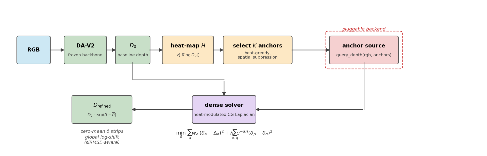

# Test-Time Anchor Refinement for Monocular Depth Estimation

This project fine-tunes Depth Anything V2 into a strong monocular depth baseline. It then asks where that baseline fails, and whether a few high-quality depth *anchors* can fix those failures at test time.

Built for the Computational Intelligence Lab (CIL 2026, ETH Zürich), Project Option 3. The metric is scale-invariant RMSE (siRMSE) on 560×560 RGB images.

**Authors:** [Eylül Öykü Şen](https://github.com/eyluloyku), [Alper Karadeniz](https://github.com/halperk), [Priyam Gupta](https://github.com/pgupta751), [Linus Reul](https://github.com/SinusLinus)



## Overview

1. **Stage A: baseline.** Depth Anything V2 (ViT-S) with LoRA adapters on the encoder and a fully trainable DPT head, trained with SILog loss. It reaches **0.461 siRMSE on validation** and **0.522 on the Kaggle test set**.
2. **Error diagnostics.** 74% of the remaining squared log-error is *gross* and not fixable at test time. Most of it is sky depth bleeding onto thin foreground objects, plus noise in the ground-truth labels. The other 26% sits at depth boundaries.
3. **Stage B: Test-Time Anchor Refinement (TTAR).** A heat map built from the baseline's own depth gradient selects K anchor pixels. A pluggable source supplies depth values at those pixels. A confidence-modulated graph-Laplacian solver then spreads the corrections into a dense, siRMSE-aware update.
4. **Anchor-source study.** The same corrector is run with three anchor sources: a ground-truth oracle (the ceiling), Apple Depth Pro (a second depth model), and DepthLM (a depth-from-language VLM).

## Results

Δ is measured against the Stage A prediction, and negative means better. Numbers are on the validation set (N=1159) unless noted otherwise.

| Method | Val siRMSE / Δ | Kaggle test |
|---|---:|---:|
| **Stage A:** DA-V2 ViT-S + LoRA | **0.4612** | **0.522** |
| TTAR + GT-oracle anchors (ceiling, K=3000) | −0.0225 (~5% rel.) | – |
| TTAR + Depth Pro anchors | +0.0264 | 0.581 |
| Depth Pro, zero-shot | 0.5151 | 0.489 |
| TTAR + DepthLM anchors, raw (N=200) | +0.213 | – |
| TTAR + DepthLM anchors, robustified (N=200) | +0.006 | – |

## Key findings

- **The oracle ceiling is modest but real.** Even perfect single-pixel anchors improve siRMSE by only ~5% relative, because most of the error is gross.
- **RGB edges do not predict where depth errors are.** They show no concentration of error mass (1.0×), which is why RGB-guided filtering doesn't help. The baseline's own depth gradient is the best test-time error signal.
- **SAM region boundaries are too poorly aligned** with true depth edges to guide boundary refinement (6.5 px vs 1.4 px median displacement).
- **Depth Pro fails as an anchor source because its errors are correlated with the baseline's** (ρ=0.94) at exactly the pixels TTAR queries.
- **An off-the-shelf DepthLM is not a usable anchor source on this data** (ρ=0.16 with ground truth). The most likely cause is that the data is out of domain for the model and lacks the camera intrinsics it expects. A robustification layer (scale alignment, outlier screening, and an agreement gate) makes even this bad source roughly harmless.

The full write-up has ablations, confidence intervals, negative results, and reproduction commands: **[docs/DETAILS.md](docs/DETAILS.md)**.

## Repository layout

```
src/
  finetune/     Stage A: DA-V2 + LoRA training, prediction, evaluation
  refine/       Stage B: heat map, dense solver, anchor backends, SAM regions, TTA
  depth_pro/    Depth Pro zero-shot predictions (anchor source)
  common/       data loading, siRMSE metric
scripts/        diagnostics, evaluation harnesses, figure scripts
slurm/          cluster job wrappers
configs/        Stage A config
apps/           Gradio app for browsing per-image errors
outputs/        report figures and FINDINGS_*.md diagnostic notes
```

## Setup

```bash
git clone --recurse-submodules <this-repo>
pip install -r requirements.txt

mkdir -p checkpoints
wget -O checkpoints/depth_anything_v2_vits.pth \
  https://huggingface.co/depth-anything/Depth-Anything-V2-Small/resolve/main/depth_anything_v2_vits.pth
```

**Data.** The dataset was provided through the course's Kaggle competition and is **not included** in this repo. To use your own copy, point `data.root` in [`configs/finetune/da_v2_vits_lora.yaml`](configs/finetune/da_v2_vits_lora.yaml) at a folder of `*_rgb.png` / `*_depth.npy` pairs.

```bash
python -m src.finetune.train    --config configs/finetune/da_v2_vits_lora.yaml
python -m src.finetune.evaluate --config configs/finetune/da_v2_vits_lora.yaml \
    --checkpoint outputs/stage_a/vits_lora_r8/checkpoints/best.pt
```

The commands for the anchor-source study and the diagnostics are in [docs/DETAILS.md § 11](docs/DETAILS.md#11-setup--reproduction).

## Acknowledgements

This repo builds on [Depth Anything V2](https://github.com/DepthAnything/Depth-Anything-V2) (included as a submodule), [Segment Anything](https://github.com/facebookresearch/segment-anything), [Apple Depth Pro](https://github.com/apple/ml-depth-pro), and DepthLM.
