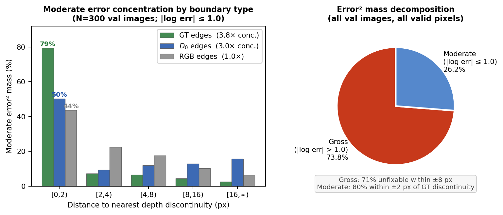
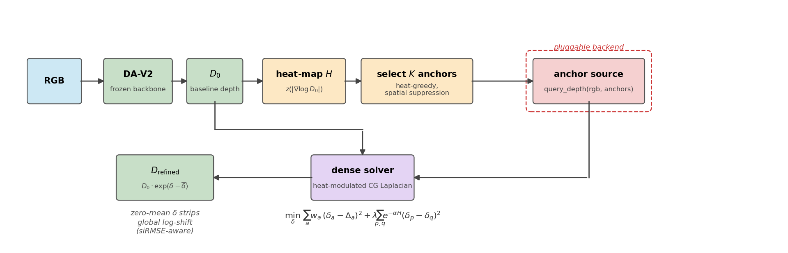
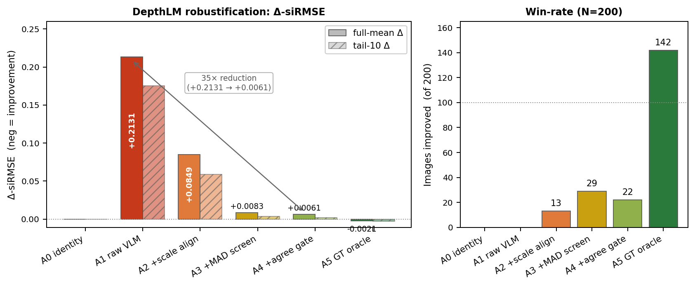

# Test-Time Anchor Refinement for Monocular Depth Estimation

**CIL 2026 — Project Option 3 (Monocular Depth Estimation).** Data: 22,605 train /
591 test RGB images at 560×560. Metric: **scale-invariant RMSE (siRMSE)** — per
pixel `dᵢ = log(predᵢ) − log(gtᵢ)`, remove the optimal scalar log-bias
`α = meanᵢ(dᵢ)` (depth scales are only meaningful *within* an image), then
`siRMSE = √(meanᵢ(dᵢ²) − (meanᵢ dᵢ)²)`, computed per image and averaged over the
set ([`src/common/metrics.py`](../src/common/metrics.py)).

> Full technical write-up: code, how to reproduce every number, and the evidence
> behind each claim. For the short version see the [main README](../README.md).

---

## 1. One-paragraph summary

We fine-tune a depth foundation model (Depth Anything V2) into a strong baseline,
then ask a sharper question than "can we train it better?": **where, exactly, does
this baseline fail, and is that failure reachable at test time?** A quantitative
error-mode study answers both. Guided by it, we design **Test-Time Anchor
Refinement (TTAR)** — a lightweight, backend-agnostic pipeline that injects a small
number of high-quality depth *anchors* into a frozen prediction and propagates them
into a dense, siRMSE-aware correction. We then run a systematic **anchor-source
study** (ground-truth oracle, a second depth model, and a depth-from-language VLM)
that establishes both the achievable ceiling and the realistic bottleneck. The
pipeline is complete and backend-agnostic; the study localizes *why* current
off-the-shelf anchor sources cannot yet realize its ceiling — the project's
central finding.

---

## 2. Results snapshot

| Stage | What | siRMSE / Δ-siRMSE (val) | Kaggle (test) |
|---|---|---:|---:|
| **A** | DA-V2 ViT-S + LoRA fine-tune (submitted model) | **0.4612** | 0.522 |
| B | TTAR + GT-oracle anchors (ceiling, K=3000 single-pixel) | −0.0225, CI [−0.0236, −0.0215] | — |
| B | TTAR + DepthPro anchors (K=3000 single-pixel, best config `rand_unif`) | +0.0264, CI [+0.0242, +0.0287] (regresses) | 0.581 |
| — | Depth Pro standalone (zero-shot, no TTAR) | 0.5151 (+0.054 vs Stage A) | 0.489 |
| B | TTAR + DepthLM-VLM anchors, raw (N=200) | +0.213, CI [+0.189, +0.238] (catastrophic) | — |
| B | TTAR + DepthLM-VLM anchors, robustified (N=200) | +0.006, CI [+0.005, +0.008] (≈ identity) | — |

`Δ-siRMSE` rows are reported relative to the Stage A prediction (negative =
improvement); **CI** is a 95% paired image bootstrap (5000 resamples). The DepthLM
rows are on a 200-image stratified subset (one VLM pass is expensive); all other
rows use the full N=1159. Full-mean Δ smaller than ~0.005 is within bootstrap noise
and is not interpreted as a real effect. Stage A is our **official submitted
entry** (Kaggle test 0.522); the Depth Pro rows were probe submissions (§7.2). The
TTAR anchor sources all regress on val, and *why* is the report's main result
(§6–§7).

**Baselines.** *Task level:* our fine-tuned Stage A (0.4612) is compared against a
second, architecturally distinct foundation model run zero-shot — Apple Depth Pro
(0.5151, §7.2) — and against zero-shot DA-V2 (no LoRA, via
`evaluate.py --no-lora`). *Refinement level:* TTAR is measured against the
identity refiner, K=0 smoothing-only, RGB-guided filtering (§5.3), and SAM
within-region smoothing (§8) — all of which fail to beat the unrefined Stage A
prediction, which is itself the reference every Δ is taken against.

---

## 3. The story (how we worked)

We present the work in the order we actually did it, because the *sequence of
decisions* is the contribution:

1. **Literature review → foundation-model baseline.** Monocular depth is dominated
   by large pretrained models. We pick Depth Anything V2 and adapt it efficiently
   with LoRA rather than training from scratch (§4).
2. **Don't trust the baseline — diagnose it.** We visualize and then *quantify* the
   residual error. It is not uniform: it splits into a large **gross** component
   (irreducible — sky-bleed on thin foreground + GT label noise) and a smaller
   **moderate** component **concentrated at depth boundaries** (§5). This decides
   everything downstream.
3. **The diagnosis rules out "just train harder."** The gross component needs a
   *better depth source*, not better optimization; the moderate component needs
   *boundary-aware* correction, not global loss tweaks.
4. **Inspired by DepthLM.** Depth-from-language models such as DepthLM report large
   gains over DA-V2-class backbones, but are far too expensive to use as a backbone
   or at training time. So we ask: **can a strong depth source be used sparsely, at
   test time only?**
5. **The method: Test-Time Anchor Refinement.** A frozen baseline prediction is
   corrected by a handful of high-quality depth *anchors* propagated through a
   heat-map-modulated, siRMSE-aware dense solver. The pipeline is **backend-agnostic**
   — any anchor source plugs into one `query_depth` interface (§6).
6. **The anchor-source study.** We evaluate three sources on the *same* corrector:
   a GT oracle (ceiling), a second monocular model (DepthPro), and a depth-from-
   language VLM (DepthLM). This turns "did it beat the baseline?" into the sharper,
   answerable question "*which depth sensor, used sparsely at test time, helps —
   and by how much?*" (§7).
7. **Honest findings, owned as contributions.** At single-pixel anchors — the
   regime DepthLM is designed for — the oracle ceiling is ~5% relative (K=3000);
   the VLM itself, on out-of-distribution data and without the camera intrinsics it
   was trained to consume, is not a usable metric oracle here. We quantify the
   symptoms (ρ=0.16 with GT, sign-flipping per-image scale) and argue the missing
   intrinsics are the most likely cause; we could not run the decisive test (an
   intrinsics-conditioned fine-tune) within the compute budget, but we ship a
   robustification layer that makes even a bad anchor source provably **safe** (§7–§8).
8. **The deliverable** is (a) a rigorous error-mode decomposition of a strong depth
   baseline on this dataset, (b) a backend-agnostic, siRMSE-aware test-time
   refinement pipeline, (c) a systematic anchor-source comparison that bounds what
   test-time refinement can do here, and (d) a reusable, source-agnostic
   robustification recipe. The pipeline is ready to receive a domain-appropriate
   anchor source — the requirement we localize precisely.

---

## 4. Stage A — strong baseline

**Backbone.** Depth Anything V2, ViT-S encoder (DINOv2) + DPT decoder, public
pretrained weights.

**Adaptation.** LoRA (rank 8, α=16, dropout 0.05) on encoder attention
`qkv`/`proj` projections only; DPT head fully trainable. Loss: scale-invariant
log (SILog, λ=0.85). 30 epochs, AdamW, cosine schedule with 2-epoch warmup.
Training at random 518×518 crops, h-flip + color jitter; inference at native
560×560. Config: [`configs/finetune/da_v2_vits_lora.yaml`](../configs/finetune/da_v2_vits_lora.yaml).

**Result** (val = a 5% hash-bucketed hold-out of the 22,605 train images, N=1159):

| Metric | mean | median | p10 | p90 |
|---|---:|---:|---:|---:|
| siRMSE | **0.4612** | 0.4461 | 0.275 | 0.676 |

Kaggle test **0.522**. Code: [`src/finetune/`](../src/finetune/). Stage A serves two
roles: it is our **official submitted entry** (test predictions in
`submissions/vits_lora_r8_v1/`, not committed — 591 large arrays) and the
**reference** that every Stage B Δ-siRMSE is measured against. The Depth Pro
variants scored in §2 were probe submissions, not our graded entry.

---

## 5. Error diagnostics — where the baseline fails

The empirical core of the report. All numbers from N=1159 val images; code in
[`scripts/diagnose_*`](../scripts/), findings in
[`outputs/diagnostics/`](../outputs/diagnostics/).


*Figure 2. Error² mass decomposes into 74% gross (structurally irreducible) and 26% boundary-concentrated; the moderate component is 3.8× concentrated within 2px of a true discontinuity. N=1159 val.*

### 5.1 The error splits in two

The baseline's per-pixel squared log-error mass decomposes into two populations
with completely different character:

| Component | Share of error² mass | Recoverable? | Character |
|---|---:|---|---|
| **Gross** (\|log err\| > 1.0, depth off > 2.7×) | **74%** | No — 71% unfixable within ±8 px | Sky depth bleeds onto thin foreground objects silhouetted against sky (91% "predicted too far"); ViT-S decoder resolution limit + GT label noise. |
| **Moderate** (the rest) | **26%** | Partially | Boundary-concentrated: 80% of its mass within ±2 px of a true depth discontinuity. The only part a *rearranging* method can touch. |

**Consequence:** any siRMSE method on this dataset is capped by the gross 74%. A
modest full-mean improvement is therefore *expected by construction* — a finding,
not a failure.

### 5.2 Which signals localize the error

Per-pixel error predictors, ranked by correlation with siRMSE-aligned error
([`diagnose_error_signals.py`](../scripts/diagnose_error_signals.py), N=1159):

| Signal | \|ρ\| | AUROC@10% | Verdict |
|---|---:|---:|---|
| `\|∇log D0\|` (depth-gradient) | **0.37** | **0.79** | strong |
| `−log D0` (near-field) | **0.36** | **0.72** | strong |
| `tta_var` (TTA prediction variance) | 0.22 | 0.64 | moderate — dominated by `\|∇log D0\|` |
| `edge_distance` | 0.13 | 0.56 | weak |
| `rgb_localstd` | 0.13 | 0.56 | weak |

The baseline's own depth gradient is the strongest test-time error proxy — it
needs no GT and drives the TTAR heat-map (§6). RGB-derived signals are weak;
TTA-variance, the only true epistemic signal we tried, is only moderate (a clean
negative result on test-time-augmentation uncertainty).

### 5.3 Two ceilings

Which edge map localizes the moderate boundary error — concentration of error mass
in the immediate [0,2) px band, by discontinuity definition:

| Edge definition | error mass % | area % | concentration |
|---|---:|---:|---:|
| `gt` — true depth discontinuities | 80.2 | 21.1 | **3.8×** |
| `d0` — baseline's own `\|∇log D0\|` | 51.0 | 17.0 | **3.0×** |
| `rgb` — grayscale RGB gradient | 44.0 | 43.3 | **1.0× — none** |

**RGB edges carry no depth-error signal** — the hard-number reason RGB-guided
filtering ([`guided_filter.py`](../src/refine/guided_filter.py)) is negligible for
depth refinement. Two oracle ceilings then frame all of Stage B:

| Refinement family | Oracle ceiling (full-mean Δ-siRMSE) | On the catastrophic top-10% tail |
|---|---:|---:|
| Sparse-anchor correction (TTAR, §6) — single-pixel anchors, K=3000 | **−0.0225** (~4.9% rel) | **−0.039** (~5.0% rel) |
| Sparse-anchor correction — smeared anchor targets (sensitivity check) | ≈ −0.005 (~1% rel) | ≈ −0.015 (~2% rel) |
| Dense boundary relocalization (warp ±2 / ±4 / ±8 px) | **−0.032 / −0.045 / −0.061** | up to −0.063 |

(Relative figures use the matching baseline mean: **0.4612** full-set, **0.7765**
tail-10%. So the full and tail "~5%" coincide despite the larger absolute tail Δ.)

TTAR is the *built and validated* path; at single-pixel anchors — the regime
DepthLM is designed for — its ceiling is ~5% relative (§7.1). Boundary
relocalization is the *identified but unrealized* path (§5.4, §8).

### 5.4 SAM segmentation — diagnostic and idea

We built a SAM-based region pipeline ([`segment.py`](../src/refine/segment.py), with
bottom-up pixel claiming so small objects aren't swallowed) to test whether
*semantic* boundaries could realize the −0.045 relocalization ceiling. Measured
against true GT depth discontinuities (N=250):

| Edge map | recall@2 px | precision@2 px | median displacement |
|---|---:|---:|---:|
| `sam` region boundaries | 37.3% | 29.4% | **6.49 px** |
| `d0` depth edges | 48.1% | 64.6% | **1.36 px** |
| `rgb` gradient | 50.2% | 23.1% | 8.65 px |

**Finding:** SAM region boundaries are *too poorly localized* (6.5 px displacement
vs 1.4 px for the baseline's own edges) to realize the boundary ceiling;
occlusion-filtering them does not help. **Semantic segmentation alone is not a
sufficient depth-boundary localizer** — a clean result that scopes the future-work
section.

---

## 6. Stage B — Test-Time Anchor Refinement (TTAR)

The method, in one line: **correct a frozen depth prediction at test time by
propagating a few high-quality depth anchors through a confidence-modulated,
siRMSE-aware dense solver.**


*Figure 1. A heat map from |∇log D0| selects K anchor pixels; a pluggable source returns log-depths via one query interface; a confidence-modulated graph-Laplacian solver propagates the corrections; a zero-mean log-shift makes the output siRMSE-aware.*

```
RGB ──→ DA-V2 (Stage A) ──→ D0  (frozen baseline depth)
                             │
                             ↓
        heat-map H = z(|∇log D0|)        ← where D0 is likely wrong
                             │
                             ↓
        select K anchor pixels  (heat-greedy or random, spatial suppression)
                             │
                             ↓
        anchor source . query_depth(rgb, anchors)   ← the pluggable backend
                             │
                             ↓
        dense solve:  min_δ  Σ_a w_a (δ(p_a) − Δ_a)²
                            + λ Σ_(p,q) exp(−α·H) (δ_p − δ_q)²
                             │
                             ↓
        D_refined = D0 · exp(δ − mean δ)     ← zero-mean: siRMSE-aware
```

**Three design choices:**

1. **Backend-agnostic.** The corrector never sees the anchor source. Any sensor that
   can return a depth at a pixel — GT, a second model, a VLM — implements one
   `query_depth(rgb, anchors) → (log_depths, confidences)` protocol
   ([`anchor_backends.py`](../src/refine/anchor_backends.py)). Swapping sources is a
   one-line change; nothing downstream moves.
2. **siRMSE-aware by construction.** siRMSE is invariant to a global log-shift, so
   the solver strips `mean δ` post-hoc — regularization budget is never spent on a
   direction the metric ignores.
3. **Confidence-modulated smoothness (optional safety term).** The smoothness penalty
   is strong where D0 is trustworthy and weak where it is suspect (`exp(−α·H)`), so
   corrections flow into error regions without bleeding across clean boundaries. In
   practice this matters mainly as a safety mechanism for heat-selected anchors; the
   best config (random anchors) works with plain uniform smoothness (§6 ablation, §7.1).

**Ablation — what the confidence modulation buys.** Oracle-anchor corrector on
N=1159 val, **patch-15 GT targets, K=100**
([`eval_anchor_sources.py --backend oracle`](../scripts/eval_anchor_sources.py)),
Δ-siRMSE vs baseline:

| Config (anchors / smoothness) | Full-mean Δ | Tail-10 Δ | Full win-rate |
|---|---:|---:|---:|
| `rand_unif` K=100 (random anchors, uniform smooth) | −0.0017 | −0.0061 | 59.6% |
| `rand_heat` K=100 (random anchors, heat-modulated) | −0.0019 | −0.0038 | 67.8% |
| `heat_heat` K=100 (heat anchors, heat-modulated) | +0.0056 | −0.0012 | 33.6% |
| `heat_unif` K=100 (heat anchors, **uniform** smooth) | **+0.1221** | catastrophic | 0–6% |
| `heat_heat` K=0 (smoothness only, no anchors) | +0.0086 | +0.0096 | 10.7% |

(These cells use **patch-15** GT targets; with single-pixel **patch-1** anchors the
low-K magnitudes differ — `rand_unif` regresses at K=100 and only helps at higher K
(§7.1, §7.3) — but the config *ordering* is identical. The `rand_unif` vs `rand_heat`
gap here, −0.0017 vs −0.0019, is within bootstrap noise; read the *sign pattern*
across configs, not the third decimal.) Uniform
smoothness paired with edge-seeking (heat) anchors is **catastrophic**
(+0.12 mean) — wrong corrections leak across boundaries — and the K=0 row shows
smoothing alone does nothing. But this is a *heat-anchor* failure: random anchors
already match or beat heat ones here (`rand_unif` ≈ `rand_heat`), and §7.1 shows
random wins at every K. So the confidence modulation is a **safety mechanism for
heat-selected anchors, not a universal gain** — the working config is random anchors
+ the siRMSE-aware zero-mean step, and the heat-map's primary role is the error
*diagnostic* (§5.2).

**Code:** [`heatmap.py`](../src/refine/heatmap.py) (heat-map + anchor selection),
[`correct_dense.py`](../src/refine/correct_dense.py) (CG graph-Laplacian solver),
[`pipeline.py`](../src/refine/pipeline.py) (`Refiner` protocol + registry),
[`eval_anchor_sources.py`](../scripts/eval_anchor_sources.py) (evaluation across all anchor backends).

---

## 7. The anchor-source study

The same corrector, three anchor sources. This is the experimental spine of the
report.

### 7.1 GT oracle — the ceiling

Anchors read from ground-truth depth: the upper bound on what *any* anchor source
could deliver through this corrector. We sweep K and the **anchor-target
sharpness** — `patch=1` returns the depth at a single pixel; `patch=15` returns a
15×15 median, a deliberately *smeared* target that probes how much the corrector
degrades when an anchor's value/localization is imprecise.

K-sweep with random anchors + uniform smoothness, GT oracle, full val (N=1159);
Δ-siRMSE vs baseline 0.4612 ([`hm_oracle_k3000_patch{1,15}`](../outputs/diagnostics/)):

| Oracle target | Metric | K=1000 | K=3000 |
|---|---|---:|---:|
| **patch=1** (single-pixel — DepthLM's design regime) | Δ full-mean | −0.0057 | **−0.0225** (4.9%; CI [−0.0236, −0.0215]) |
| | Δ tail-10 | −0.0115 | **−0.0388** (5.0%; CI [−0.0433, −0.0345]) |
| | win-rate (full / tail-10) | 70% / 71% | **98% / 98%** |
| **patch=15** (15×15 median — smeared-target sensitivity check) | Δ full-mean | −0.0041 | −0.0047 |
| | Δ tail-10 | −0.0121 | −0.0154 |
| | win-rate (full / tail-10) | 62% / 85% | 62% / 90% |

**Two regimes:**

- **Sharp single-pixel anchors keep scaling.** patch=1 roughly *quadruples* its gain
  from K=1000 to K=3000 — reaching **−0.0225 full-mean / −0.0388 tail-10** (≈5%
  relative — full Δ over 0.4612, tail Δ over the 0.7765 tail baseline) and improving
  98% of all images.
- **Smeared targets saturate.** patch=15 plateaus near −0.005 full / −0.015 tail-10
  — adding anchors past K≈1000 buys almost nothing, because a patch median across a
  depth boundary is an ill-defined target.

**Reading.** patch=1 is DepthLM's regime: it is **queried per-pixel** — a marker
(arrow) is rendered *pointing at* the single query pixel, leaving the pixel itself
intact, and accurate pixel referencing is a concern its marker design explicitly
targets. So a DepthLM-anchored TTAR could in principle reach the patch=1
**≈5%-relative** ceiling — but note that figure is a **K=3000** result. At the K=50
a VLM can realistically afford (§7.3), even a *perfect* single-pixel oracle
regresses, so realizing the ceiling needs **two** things: anchor **accuracy** *and*
a **high query budget**. §7.3 measures the accuracy axis; the budget is the second.
The patch=15 row stays as a sensitivity result: it quantifies how fast the corrector
degrades if anchor values are imprecise (the corrector needs its anchors to be both
correct *and* well-localized).

**Anchor *selection*: random beats heat, even at a matched budget.** The heat map
localizes D0's error (§5.2), so it is the natural anchor selector — but it is not
the best one. Sweeping K with heat selection allowed to reach the full anchor budget
([`hm_oracle_ksweep_heatfull`](../outputs/diagnostics/), single-pixel oracle), heat-
selected anchors still *regress* the baseline while random ones improve it, at every K:

| K | `rand_unif` Δ | `heat_heat` Δ |
|---|---:|---:|
| 100 | +0.0079 | −0.0001 |
| 1000 | −0.0058 | +0.0638 |
| 3000 | **−0.0224** | +0.0179 |

Random, uniformly-spread anchors propagate cleanly; heat anchors cluster on boundary
curves, where a single-pixel oracle value injected next to a depth jump makes the
solver over/undershoot. So the **ceiling config is `rand_unif`** (random anchors +
uniform smoothness), and the heat-map's value is as the error *diagnostic* and the
smoothness *guide that rescues heat anchors* (§6) — not as the anchor selector.

(The oracle `rand_unif` K=3000 ceiling appears across sections as −0.0224/−0.0225
(full-mean) and −0.0388/−0.0396 (tail-10) — the small spread is two runs that agree
within their 95% CIs.)


### 7.2 Depth Pro — a second foundation model as the anchor source

The VLM (§7.3) is one realistic anchor source; a **second monocular foundation
model** is the other obvious one. We test Apple **Depth Pro** — architecturally
different from Stage A (different encoder, decoder, and training data), one forward
pass per image, no VLM cost — through the *same* corrector, at the *same* K=3000
single-pixel configuration that defines the GT-oracle ceiling in §7.1.

**Standalone Depth Pro on the full val set (N=1159):**

| Metric | mean | median | p10 | p90 |
|---|---:|---:|---:|---:|
| siRMSE | **0.5151** | 0.4943 | 0.329 | 0.749 |

Depth Pro is **+0.054 siRMSE worse than Stage A** (0.4612) on val: architecturally
decorrelated but weaker on the val distribution — the wrong half of the
*accurate-and-decorrelated* requirement an anchor source must meet.

**A val/test caveat we report openly.** On the *Kaggle test* set the standalone
ranking flips: Depth Pro scores **0.489** vs Stage A's **0.522** (§2) — on the
test distribution it is the *stronger* standalone model, the opposite of val. We
attribute this to the small 5% val hold-out plus distribution shift, and flag it
rather than hide it. Crucially, it does **not** rescue the anchored result: TTAR's
failure is driven by Depth Pro's *local* error at the specific boundary/near-field
pixels it is queried at (median |log err| **1.067** vs Stage A's **0.372**, signed
errors ρ=0.94 correlated — below), a per-pixel property that a better *global*
siRMSE does not address. The anchor-source diagnosis therefore stands regardless of
which model wins the standalone score.

**TTAR + Depth Pro vs the GT-oracle ceiling — same corrector, same K=3000
single-pixel anchors, only the source changes** (N=1159 val, Δ-siRMSE vs baseline
0.4612; [`anchors_depth_pro_ksweep_heatfull`](../outputs/diagnostics/) vs
[`hm_oracle_ksweep_heatfull`](../outputs/diagnostics/); heat configs place ~2970 anchors):

| Config | GT oracle (full / tail-10 / wr-tail10) | Depth Pro (full / tail-10 / wr-tail10) |
|---|---|---|
| `rand_unif` (ceiling config) | **−0.0224** / −0.0396 / 100% | **+0.0264** / +0.0328 / 12.1% |
| `rand_heat` | −0.0209 / −0.0358 / 95.7% | +0.0375 / +0.0484 / 6.9% |
| `heat_heat` (pixel-identical anchors) | +0.0179 / +0.0060 / 50.9% | +0.0990 / +0.1072 / 0.9% |
| `heat_unif` | +0.0673 / +0.0289 / 28.4% | +0.1016 / +0.0901 / 5.2% |

**Every Depth Pro configuration regresses the baseline.** At the exact `rand_unif`
K=3000 single-pixel config that gives the oracle its **−0.0224** ceiling, Depth Pro
gives **+0.0264** — it makes the prediction *worse* where perfect anchors make it
~5% better, and tail-10 win-rate collapses from 100% to 12%. The `heat_*` configs use
*pixel-identical* anchors for both sources (heat selection is deterministic on D0),
so `heat_heat` (+0.0179 oracle vs +0.0990 Depth Pro) isolates the effect to the
anchor **value** alone.

The selection ordering matches the oracle (§7.1): for *both* sources random anchors
beat heat anchors (Depth Pro `rand_unif` +0.0264 vs `heat_heat` +0.0990) — heat
selection concentrates anchors on the boundary pixels where the source is least
accurate, so for an imperfect source it is the worst place to query.

**Failure mode — Depth Pro shares Stage A's errors.** The per-pixel root-cause
([`FINDINGS_anchors_depth_pro_rootcause.md`](../outputs/diagnostics/FINDINGS_anchors_depth_pro_rootcause.md),
heat-selected anchors) shows why. At the heat-selected pixels TTAR queries, Stage A's
median \|log err\| is **0.372** while Depth Pro's is **1.067** (≈2.9× worse) — and
the two models' signed errors are **correlated (ρ=0.94)** and **same-signed 62%** of
the time. Where Stage A over-predicts (sky bleeding onto thin foreground), Depth Pro
over-predicts too, usually by more. It is therefore *neither* decorrelated *nor*
locally accurate at the queried pixels — the same two-property failure as the VLM
(§7.3), reached from the opposite direction.

**What this adds to the story.** Two architecturally distinct off-the-shelf sources
— a second monocular foundation model and a depth-from-language VLM — both fail to
realize the ceiling, and for the *same underlying reason*: at the boundary and
near-field pixels where Stage A errs, they err too. **The corrector is not the
bottleneck; the anchor source is.** Crucially, swapping in another monocular
foundation model does *not* escape the shared failure mode — which is exactly what
motivates a source that reasons about the scene through a *different* channel (§8).

### 7.3 DepthLM-VLM — the semantic source, diagnosed

We test **DepthLM (Pixtral-12B)**, a depth-from-language VLM, as the anchor source.
Six-row ablation on 200 stratified val images, single VLM pass cached
([`eval_robust_ablation.py`](../scripts/eval_robust_ablation.py),
[`FINDINGS_robust_vlm.md`](../outputs/diagnostics/FINDINGS_robust_vlm.md)):


*Figure 3. The three-stage recipe (scale align → MAD screen → agreement gate) reduces the raw +0.213 regression 35× to +0.006 (≈ identity), but cannot cross into a net gain.*

| Row | Full-mean Δ | 95% CI (full) | Tail-10 Δ | Win-rate | n_refined |
|---|---:|---:|---:|---:|---:|
| `A0` identity | +0.0000 | — | +0.0000 | — | 0 |
| `A1` raw VLM anchors | **+0.2131** | [+0.189, +0.238] | +0.1752 | 0/200 | 200 |
| `A2` + per-image scale alignment | +0.0849 | [+0.069, +0.101] | +0.0589 | 13/200 | 200 |
| `A3` + MAD outlier screening | +0.0083 | [+0.007, +0.010] | +0.0035 | 29/200 | 197 |
| `A4` + agreement gate (robust pipeline) | **+0.0061** | [+0.005, +0.008] | +0.0017 | 22/200 | 140 |
| `A5a` GT oracle, K=50 **patch-1** (DepthLM's per-pixel regime) | **+0.0068** | [+0.003, +0.012] | +0.0101 | 100/200 | 200 |
| `A5b` GT oracle, K=50 patch-15 (smoothed target) | −0.0021 | [−0.003, −0.001] | −0.0029 | 142/200 | 200 |

95% CIs are the same paired bootstrap as elsewhere, on this 200-image subset. Two
reads follow. **(i)** The robustified VLM's CI **[+0.005, +0.008] sits entirely
above zero** — provably *not* a gain, only ~35× smaller damage than raw. **(ii)**
The oracle rows are the real lesson: at the **K=50** budget DepthLM could afford
(each anchor is a ~2 s VLM call; K=3000 ≈ 3000 calls/image), even a *perfect*
single-pixel oracle (`A5a`) **regresses (+0.0068)** and is statistically
indistinguishable from the robustified VLM (`A4`, +0.0061) — single-pixel anchors
are simply the wrong regime at low K. A smoothed-target oracle (`A5b`) barely helps
(−0.0021). The real headroom needs *density*: §7.1's −0.0225 ceiling is a **K=3000**
result. So at the budget we could afford, **no source — VLM or GT oracle — helps
with single-pixel anchors**; the motivated path is a *more accurate* VLM
(domain-adapted, intrinsics-conditioned) queried at *much higher K* under a larger
compute budget, where §7.1 shows the corrector delivers ~5%.

The robustification staircase converts a **+0.21 catastrophe into a +0.006 no-op**
(35× reduction). Per-quartile by baseline difficulty (Q1 easiest → Q4 hardest):

| Quartile | baseline siRMSE | A1 raw Δ | A4 robust Δ | A5b oracle Δ (patch-15) |
|---|---:|---:|---:|---:|
| Q1 | 0.280 | +0.2326 | +0.0109 | −0.0005 |
| Q2 | 0.396 | +0.1991 | +0.0059 | −0.0015 |
| Q3 | 0.497 | +0.2375 | +0.0046 | −0.0040 |
| Q4 | 0.675 | +0.1831 | +0.0027 | −0.0026 |

The agreement gate's threshold τ trades coverage for safety, monotonically toward
identity — **no τ produces a net gain**, confirming the gate is damage-control,
not a source of improvement (`n_gate_open` = images the gate admits; a couple are
then dropped by the min-anchor screen, so it slightly exceeds the staircase's
`n_refined`):

| τ_gate | n_gate_open | Δ-mean | Δ-tail10 |
|---:|---:|---:|---:|
| −1 (refine all) | 200 | +0.0083 | +0.0035 |
| 0.0 (default) | 142 | +0.0061 | +0.0017 |
| 0.2 | 110 | +0.0047 | +0.0016 |
| 0.5 | 56 | +0.0025 | +0.0006 |
| 1.1 (refine none) | 0 | +0.0000 | +0.0000 |

**Failure, quantified.** We measure the failure directly: per-image scale bias has
median 4.4× *and flips sign by image*; per-pixel structure correlation with GT is
only **ρ=0.16** (vs **ρ=0.89** for the DA-V2 baseline itself). The VLM is here
neither accurate *nor* decorrelated — the two properties a useful anchor source
needs. The most likely cause is the missing camera-intrinsic / focal-length
conditioning DepthLM was trained to consume, compounded by the OOD data; the
decisive test — an intrinsics-conditioned fine-tune — is the future work below.

**What we still deliver.** The staged **robustification recipe** (per-image scale
alignment → MAD screening → cross-source agreement gate) is anchor-source-agnostic
and makes plugging in an *untrusted* sensor provably safe — a contribution
independent of whether the VLM itself works.

**Why we did not fine-tune the VLM.** Domain-adapting a 12B depth-VLM to the CIL
distribution (with correct intrinsics) and querying it at the high K the corrector
needs (§7.1) are the two obvious fixes, but both exceeded our remaining compute
budget. The pipeline is built to receive them: a domain-adapted DepthLM drops into
the same backend with no other change, at any K.

---

## 8. Negative results, owned as findings

The report leads *with* these, not around them. Each is a clean, quotable result
that future test-time-refinement work needs:

1. **A SOTA depth baseline's error on this data is 74% structurally irreducible**
   (sky-bleed on thin foreground + GT label noise). Any siRMSE method here has a
   modest full-mean ceiling by construction.
2. **RGB-edge guidance does not localize depth error** (1.0× concentration) — the
   reason photometric guided filtering fails for depth refinement.
3. **An off-the-shelf metric-depth VLM is not a usable test-time oracle on this OOD
   data** — ρ=0.16 with GT, +0.21 raw siRMSE regression. We quantify the symptoms
   (sign-flipping per-image scale bias, near-zero structure correlation) and argue
   missing camera intrinsics are the most likely cause.
4. **Sparse-anchor correction has real headroom — ~5% relative** with single-pixel
   oracle anchors at K=3000 (DepthLM's per-pixel query regime); a smeared anchor
   target degrades this to ~1%, so the corrector needs anchors that are both
   accurate *and* well-localized. The complementary headroom (−0.045, boundary
   relocalization) needs a boundary localizer better than SAM (6.5 px
   displacement) — the clearest future direction.
5. **Selective application and TTA-variance uncertainty add nothing** — two more
   axes ruled out cleanly.
6. **Within-region smoothing over SAM regions carries no siRMSE signal** — the
   companion to the §5.4 localizer result. A within-region smoothing control
   ([`region_smooth.py`](../src/refine/region_smooth.py)) blends D0 toward a
   per-region target in log space and was swept across four variants on a
   200-image val subsample (baseline 0.4659): per-region **median** (Δ-mean
   +0.0005 → +0.0114 over α=0.2→0.8), **planar fit** (+0.0005 → +0.0096), planar
   **+ residual gate** (squashes to ≈0 but non-selectively — it shrinks help and
   harm in lockstep), and planar **+ boundary-only rim** (~43% the magnitude of
   full-region, no sign flip). Every variant is monotone-negative or a no-op.
   Stage A's per-pixel predictions are already finer than any region-level
   summary, so smoothing either discards useful within-region variation or fights
   non-planar geometry — which is *why* TTAR corrects with between-region anchors
   rather than within-region averaging.
7. **Off-the-shelf foundation-model anchor sources are capped by *correlated*
   error — which motivates language-grounded depth.** A second monocular foundation
   model (Depth Pro, §7.2) fails as an anchor source not from weakness alone but
   because its errors are correlated with Stage A's (ρ=0.94, 62% same-sign) at
   exactly the pixels TTAR queries: swapping one RGB→depth foundation model for
   another inherits the same sky-bleed failure mode. Escaping it requires a source
   that reasons about the scene through a *different* channel. Depth-from-language
   VLMs (DepthLM-style), which report large gains on metric depth and are explicitly
   engineered for accurate per-pixel queries, are therefore the **better-motivated**
   future direction *despite* our negative result (§7.3) — which, on the evidence, is
   most consistent with OOD evaluation and missing camera intrinsics rather than a
   flaw in the approach, though the decisive test (an intrinsics-conditioned
   fine-tune) was outside our compute budget. A domain-adapted, intrinsics-conditioned
   VLM is the natural next anchor source, and the pipeline accepts it unchanged.

Together these *map the territory* of test-time depth refinement: they say which
levers are real and which are dead. That map is the contribution.

---

## 9. Claims and evidence

| Topic | Lead claim | Evidence |
|---|---|---|
| Intro / Related work | MDE is foundation-model-dominated; test-time refinement is the natural place to inject expensive depth sources | §3 |
| Method — Stage A | Efficient LoRA adaptation of DA-V2 → competitive baseline (0.461 / 0.522) | §4 |
| Method — diagnostics | Error decomposes 74% gross / 26% boundary-concentrated; RGB edges useless; defines two ceilings | §5 |
| Method — TTAR | Novel backend-agnostic, siRMSE-aware, confidence-modulated test-time corrector | §6 |
| Experiments | Anchor-source study: oracle ceiling ~5% relative at single-pixel anchors (DepthLM's regime), DepthPro realistic row, VLM diagnosed + robustified | §7 |
| Analysis / Conclusion | Pipeline complete; bottleneck is the anchor source, localized precisely; boundary relocalization is the −0.045 future direction | §5.3, §8 |

**Key figures** (all in [`outputs/figures/`](../outputs/figures/)):

| # | File | Content |
|---|---|---|
| 1 | [`fig1_pipeline.pdf`](../outputs/figures/fig1_pipeline.pdf) | TTAR pipeline diagram |
| 2 | [`fig2_boundary_hist.pdf`](../outputs/figures/fig2_boundary_hist.pdf) | Error mass vs distance to discontinuity — 74/26 split + boundary concentration |
| 3 | [`fig3_vlm_staircase.pdf`](../outputs/figures/fig3_vlm_staircase.pdf) | DepthLM robustification staircase (+0.213 → +0.006) |

Scripts: [`scripts/figures/`](../scripts/figures/). All run locally without a GPU; fig2 reads from
[`outputs/diagnostics/boundary_phase0/results.json`](../outputs/diagnostics/boundary_phase0/results.json).

---

## 10. Repository map

```
src/
  finetune/        Stage A — DA-V2 + LoRA training, predict, evaluate
    train.py model.py losses.py predict.py evaluate.py
  refine/          Stage B — TTAR
    heatmap.py         error heat-map + anchor selection
    correct_dense.py   confidence-modulated CG dense solver
    anchor_backends.py anchor-source protocol: oracle / second-model / DepthLM
    pipeline.py        Refiner protocol + IdentityRefiner + registry
    segment.py         SAM region extractor (boundary diagnostics, §5.4)
    region_smooth.py   SAM within-region smoothing control (§8)
    tta.py             TTA prediction-variance uncertainty
    guided_filter.py   RGB-guided post-process (Stage A)
  depth_pro/       Apple Depth Pro zero-shot predictions (§7.2 anchor source)
    predict.py         mirrors src/finetune/predict.py interface; supports --skip-existing
  common/          data loading, siRMSE metric, utils
scripts/
  diagnose_*.py    error-mode / signal / SAM / DepthLM diagnostics
  eval_*.py        corrector + anchor-source evaluation harnesses
  probe_*.py       targeted probes (gross-error, counterfactual sky)
  fit_selective_gate.py / precompute_tta_variance.py / visualize_cases.py
slurm/             cluster job wrappers (one per script)
configs/finetune/  Stage A config
outputs/
  stage_a/         trained checkpoint
  val_preds/       baseline predictions on val (corrector input)
  diagnostics/     all FINDINGS_*.md + per-experiment runs
submissions/       Kaggle submission (Stage A)
```

### Findings index

All diagnostics write a dated `FINDINGS_*.md` in
[`outputs/diagnostics/`](../outputs/diagnostics/), cited throughout this README:

- `FINDINGS_boundary_phase0.md` — error decomposition + relocalization ceiling (§5.1, §5.3)
- `FINDINGS_corrector_oracle.md`, `FINDINGS_phase1.md` — TTAR oracle ablations (§6)
- `FINDINGS_tail_kssweep.md` — anchor K-sweep on the tail (§7.1)
- `FINDINGS_phase2c.md`, `FINDINGS_phase3.md` — TTA-variance + selective-gate negatives (§8)
- `FINDINGS_robust_vlm.md` — DepthLM anchor-source ablation (§7.3)

---

## 11. Setup & reproduction

```bash
pip install --user -r requirements.txt
mkdir -p checkpoints logs/slurm

# Depth Anything V2 ViT-S (Stage A backbone)
wget -O checkpoints/depth_anything_v2_vits.pth \
  "https://huggingface.co/depth-anything/Depth-Anything-V2-Small/resolve/main/depth_anything_v2_vits.pth"
# SAM ViT-B (segmentation diagnostic, §5.4)
wget -O checkpoints/sam_vit_b.pth \
  "https://dl.fbaipublicfiles.com/segment_anything/sam_vit_b_01ec64.pth"

# Apple Depth Pro (§7.2 anchor source — installed at ~/ml-depth-pro on the cluster)
#   git clone https://github.com/apple/ml-depth-pro ~/ml-depth-pro
#   pip install --user -e ~/ml-depth-pro
#   cd ~/ml-depth-pro && bash get_pretrained_models.sh
#   cp ~/ml-depth-pro/checkpoints/depth_pro.pt checkpoints/depth_pro.pt
```

**Data.** From the Kaggle competition (Project Option 3). Point `data.root` in the
config at your copy of `train/`; the default is the cluster path
`/cluster/courses/cil/monocular-depth-estimation/`.

**Environment.** Off-cluster, `requirements.txt` covers Stage A, the corrector, and
the figures. On the student cluster the slurm wrappers activate a provided conda env
(`monocular-depth-estimation` on 1080-class GPUs, `monodepth-5060` elsewhere); the
Depth Pro and DepthLM backends require `monodepth-5060`.

```bash
# Stage A — train, evaluate (reproduces val siRMSE 0.4612), predict val + submitted test
python -m src.finetune.train    --config configs/finetune/da_v2_vits_lora.yaml
python -m src.finetune.evaluate --config configs/finetune/da_v2_vits_lora.yaml \
    --checkpoint outputs/stage_a/vits_lora_r8/checkpoints/best.pt        # -> val siRMSE 0.4612
python -m src.finetune.predict  --config configs/finetune/da_v2_vits_lora.yaml \
    --checkpoint outputs/stage_a/vits_lora_r8/checkpoints/best.pt \
    --val --out-dir outputs/val_preds/vits_lora_r8/
# Submitted prediction (Kaggle test 0.522):
python -m src.finetune.predict  --config configs/finetune/da_v2_vits_lora.yaml \
    --checkpoint outputs/stage_a/vits_lora_r8/checkpoints/best.pt \
    --test-root /cluster/courses/cil/monocular-depth-estimation/test \
    --out-dir submissions/vits_lora_r8_v1/preds/
python /cluster/courses/cil/monocular-depth-estimation/create_submission.py   # -> submission.csv
# Zero-shot DA-V2 baseline (no LoRA), for the task-level comparison in §2:
python -m src.finetune.evaluate --config configs/finetune/da_v2_vits_lora.yaml --no-lora

# Stage B — anchor-source study (oracle / second-model / vlm)
sbatch slurm/eval_anchor_sources.sbatch --backend oracle \
    --out-dir outputs/diagnostics/anchors_oracle/

# Depth Pro — zero-shot val predictions (§7.2 anchor source; supports --skip-existing for safe resume)
sbatch slurm/predict_depth_pro.sbatch \
    checkpoints/depth_pro.pt \
    outputs/val_preds/depth_pro/ \
    --val --config configs/finetune/da_v2_vits_lora.yaml

# TTAR + Depth Pro anchor-source eval (§7.2; requires Stage A val preds first)
sbatch slurm/eval_anchor_sources.sbatch \
    --backend second \
    --second-preds-dir outputs/val_preds/depth_pro/ \
    --second-name depth_pro \
    --out-dir outputs/diagnostics/anchors_depth_pro/

# Diagnostics
sbatch slurm/diagnose_error_signals.sbatch     --out-dir outputs/diagnostics/error_localizability/
sbatch slurm/diagnose_boundary_errormode.sbatch --out-dir outputs/diagnostics/boundary_phase0/
```
